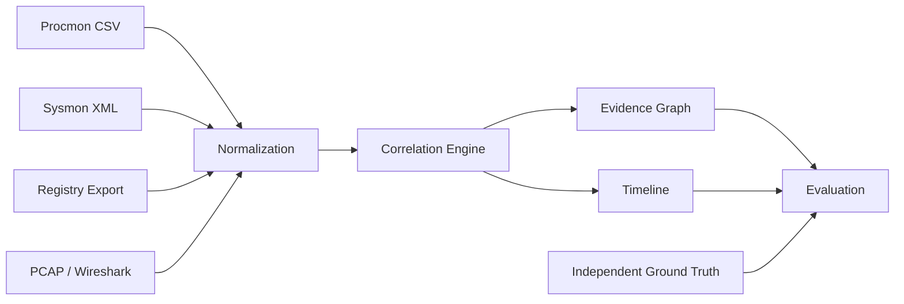

# Cross-Artifact Incident Reconstruction Using Process, Registry and Network Evidence

## Abstract

This project investigates whether independently collected process, Registry and network evidence can reconstruct an incident more completely than isolated forensic sources. Method 3 applies conventional process/PID, timestamp, Registry and network rules without graph reachability. Method 4 uses the resulting provenance relationships as evidence edges and performs limited causal path reconstruction from suspect process seeds. The repository provides synthetic development and held-out scenario evaluation, but real Windows captures are still required before any real-world superiority claim.

## Introduction

Endpoint and network investigations often operate in separate tools and exports. Process evidence establishes execution, Registry evidence exposes persistent state, and packet evidence records network communication. Independent observations can be correlated through process identity, process epochs, Registry attribution and transport five-tuples.

## Problem Statement

Process/PID identifiers alone are ambiguous under PID reuse and concurrent processes. Registry snapshots lack timing information in many exports. Wireshark frames cannot safely be attributed to processes by timestamp alone. The system therefore separates direct observations from inferred context and preserves evidence provenance.

## Literature Review

The implementation uses process lineage, temporal evidence windows, Sysmon endpoint telemetry, packet evidence and graph-based incident reconstruction. Claims in the final report must distinguish provenance and causality from correlation. The design should also be compared against general host/network intrusion reconstruction, provenance graph and EDR timeline literature in the final scholarly citation list.

## Research Objectives

1. Compare process-only, network-only, process-plus-Registry and all-source rule-based baselines.
2. Demonstrate multi-hop cross-artifact reconstruction with the proposed graph method.
3. Quantify precision, recall, F1, false-positive rate, event coverage and relationship accuracy.
4. Measure timeline accuracy against independently recorded chronology.
5. Test feature ablations and timestamp tolerances.
6. Validate synthetic held-out cases and prepare real controlled Windows experiments.

## Proposed Methodology

### Method 3

Method 3 correlates source evidence through ProcessGuid/PID, process lifetime, exact network tuple and timestamp constraints. It does not discover additional incident events by traversing evidence graph paths.

### Method 4

Method 4 constructs a directed evidence graph from high-confidence relationship objects. Starting from process-seed events, it retains nodes participating in trusted causal paths up to seven hops. The distinction is path-based reconstruction and explanation, not merely graph visualization.

## System Architecture

## Experimental Setup

The authoritative synthetic catalog has 19 development scenarios (`CASE-01` to `CASE-19`) and 3 held-out scenarios (`CASE-20` to `CASE-22`). Scenarios are independent; events are not split across development and held-out sets. CASE-20 tests mixed reconstruction, CASE-21 PID reuse, and CASE-22 missing Registry evidence with noise.

## Evaluation Methodology

Ground truth is stored separately from parser and correlation output. Event metrics use the union of normalized events. Relationship metrics compare exact source, target and relationship-type triples. Timeline accuracy compares predicted and ground-truth incident chronology. The report must not present synthetic held-out evaluation as real-world performance.

## Ablation Study

The ablation suite explicitly disables ProcessGuid, timestamp matching, Registry evidence, network five-tuple matching or process lifetime validation in the correlation engine.

## Sensitivity Analysis

The configured tolerances are ±1, ±5, ±10 and ±30 seconds. The stress catalog covers network noise, concurrent processes, PID reuse and missing evidence.

## Limitations

- Synthetic evidence does not establish real-world validity.
- Static Registry snapshots cannot supply historical timestamps.
- Wireshark packets are not attributed to a process without corroboration.
- Process and network evidence may contain loss or clock-skew.
- A generated relationship is not proof of application-level intent.

## Conclusion

The corrected evaluation pipeline distinguishes graph reconstruction from rule-based correlation and preserves dataset and evidence provenance. Real Windows validation is a required next stage before external claims.

## Future Work

Add real captures, independent reviewers, uncertainty intervals, repeated trials, EVTX parsing, clock synchronization analysis and independent commercial-tool comparison.
